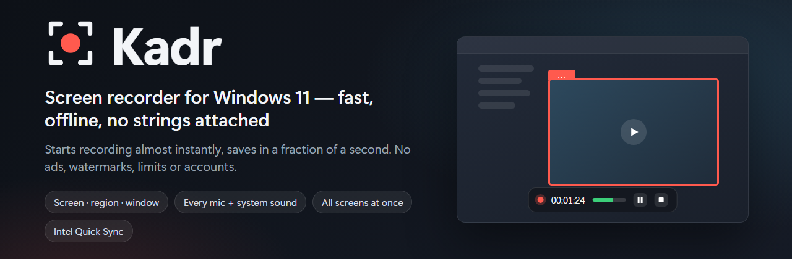
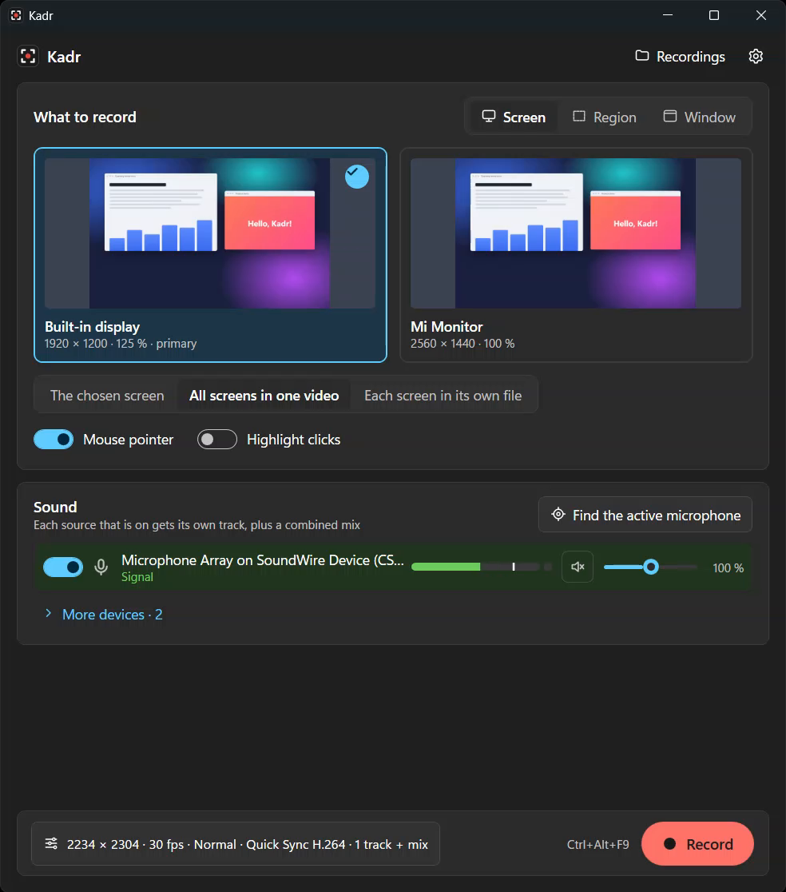
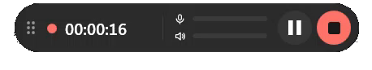
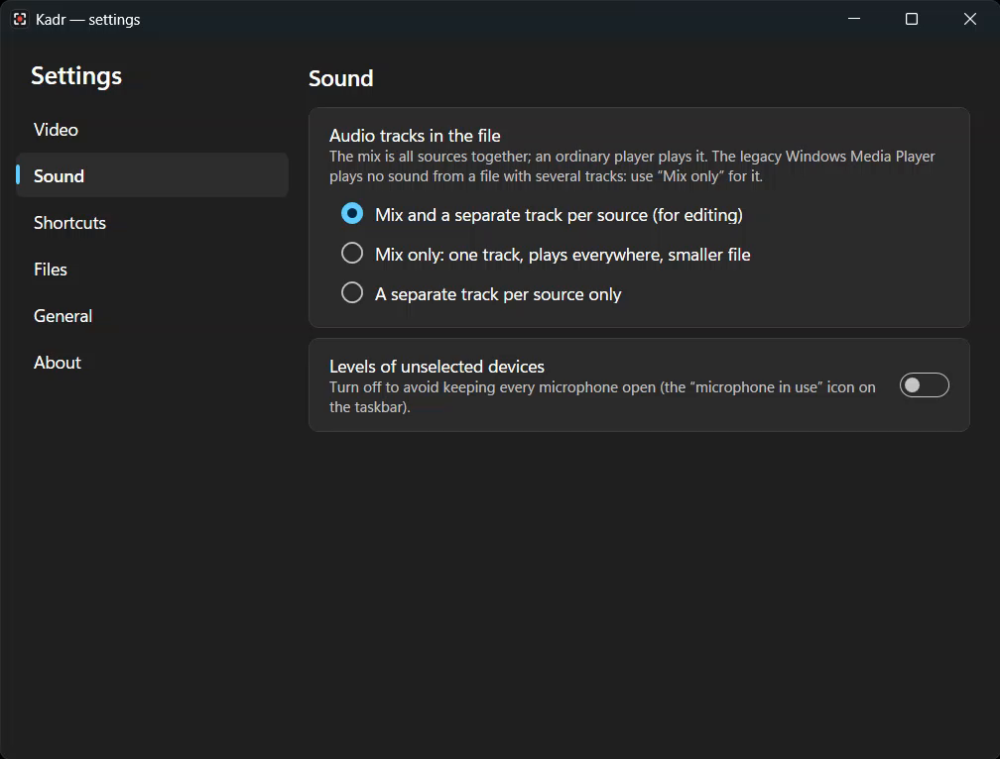
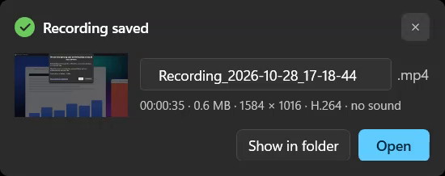

<p align="center">
  
</p>

<p align="center">
  <a href="https://github.com/Ilyakz/kadr/releases/latest"><b>⬇ Download the latest version</b></a>
  &nbsp;·&nbsp; <a href="README.ru.md">Русская версия</a>
</p>

**Kadr** is a simple screen recorder for Windows 11. It starts recording almost the moment you press
the button, saves in a fraction of a second, and never phones home: no ads, no watermarks, no time
limits, no account, no telemetry, no automatic updates.

<p align="center">
  
</p>

## What it can do

- **Record** a whole monitor, a region you draw, a single window (even when other windows cover it)
  or one browser tab.
- **All screens at once** — in one video, laid out as in Windows display settings, or each screen
  into its own file, started and stopped together.
- **Every sound source** — any number of microphones and the system sound (what you hear), each with
  its own level meter, volume and mute. The file gets one mixed track, a separate track per source
  for editing, or both — your choice.
- **Pause** without gaps or lost sync, a **3-2-1 countdown**, a small **floating panel** while
  recording, **global shortcuts**, optional **click highlights**.
- **Move the recorded region while recording** — drag the tab on its frame.
- **Never loses a recording**: the file stays readable even if the app or the encoder crashes, and
  Kadr offers to recover it on the next start.
- **Fast**: hardware encoding with Intel Quick Sync (H.264 or AV1), or Windows' own H.264 encoder on
  other hardware. Saving is a rename, not a second pass.
- Lives in the **tray**: the close button hides the window, shortcuts keep working.
- Interface in **English and Russian**, light and dark theme following Windows.

<p align="center">
  <br>
  <sub>While recording: a small floating panel that never gets into the video</sub>
</p>

<table>
  <tr>
    <td width="55%"></td>
    <td width="45%"></td>
  </tr>
  <tr>
    <td align="center">Choose which audio tracks go into the file</td>
    <td align="center">Saved: rename right away, open, or show in the folder</td>
  </tr>
</table>

## Install

Download from **[Releases](https://github.com/Ilyakz/kadr/releases/latest)**:

| File | What it is |
|---|---|
| `Kadr-<version>-setup.exe` | Installer. Installs for your user only (no administrator rights needed); "for all users" can be chosen in the first step. |
| `Kadr-<version>-portable.zip` | Portable version: unpack anywhere and run `Kadr.exe`. Settings stay in the `data` folder next to it. |
| `SHA256SUMS.txt` | Checksums of the files above. |

**"Windows protected your PC"?** The installer is not code-signed yet, so Microsoft SmartScreen does
not know it. Click **More info → Run anyway**. To make sure the file is the one published here,
compare its checksum with `SHA256SUMS.txt`:

```powershell
Get-FileHash .\Kadr-1.1.0-setup.exe -Algorithm SHA256
```

**Requirements:** Windows 10 version 2004 or later, Windows 11 recommended; 64-bit. An Intel GPU with
Quick Sync gives the fastest recording; without it Kadr uses the Windows H.264 encoder.

## Use

1. Choose what to record: **Screen**, **Region** or **Window** (browser windows also list their tabs).
2. Tick the sound sources. The meters show which microphone actually hears you.
3. Press **Record** or `Ctrl+Alt+F9`. During the 3-2-1 countdown the encoder gets ready, so the
   recording starts exactly when it ends.
4. Control it from the floating panel, the tray icon or the shortcuts: pause `Ctrl+Alt+F10`,
   stop `Ctrl+Alt+F11`, microphone on/off `Ctrl+Alt+F12` (all can be changed in Settings).
5. After Stop, a notification lets you rename the file, open it or show it in the folder.

Recordings go to `Videos\Kadr` (the folder and the file name pattern can be changed in Settings).
To exit, right-click the tray icon → **Exit**.

**No sound in the old Windows Media Player?** It plays no sound from files with several audio tracks.
Set **Settings → Sound → Audio tracks in the file → Mix only**: one track that plays everywhere.

## Privacy

Kadr works fully offline. It sends nothing anywhere, checks for no updates and needs no account.
It does not start with Windows. Settings and logs are in `%LOCALAPPDATA%\Kadr` (or in `data` next to
the portable version); uninstalling asks whether to remove them. Recordings are never deleted.

## License

Kadr is free to use — see [LICENSE](LICENSE). It includes FFmpeg (LGPL 2.1, built without GPL
components) and other open-source components, listed in [THIRD-PARTY-NOTICES.txt](THIRD-PARTY-NOTICES.txt).
The FFmpeg source code and the exact build scripts for each version are attached to its
[release](https://github.com/Ilyakz/kadr/releases).
