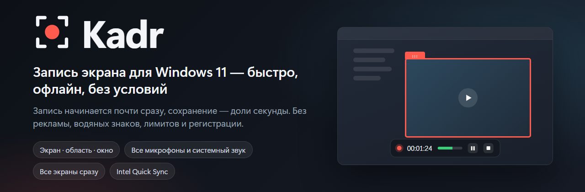
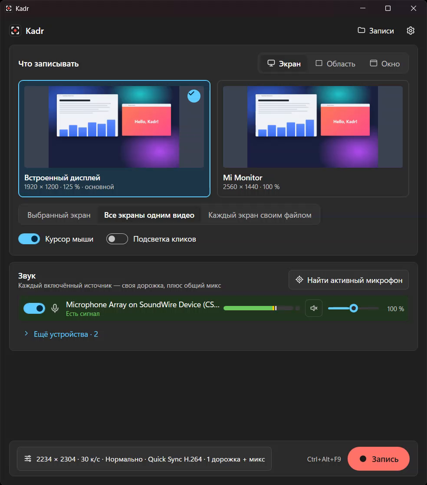
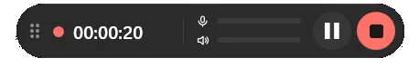
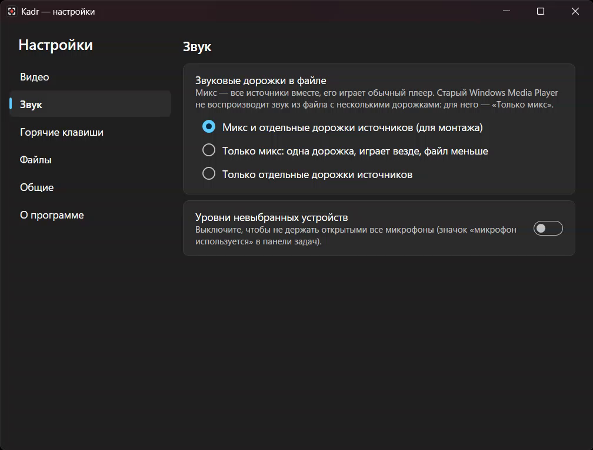
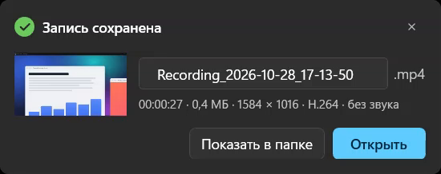

<p align="center">
  
</p>

<p align="center">
  <a href="https://github.com/Ilyakz/kadr/releases/latest"><b>⬇ Скачать последнюю версию</b></a>
  &nbsp;·&nbsp; <a href="README.md">English</a>
</p>

**Kadr** — простая программа для записи экрана в Windows 11. Запись начинается почти сразу после
нажатия, сохранение занимает доли секунды, и программа никуда не ходит: без рекламы, водяных знаков,
ограничений по времени, регистрации, телеметрии и автообновлений.

<p align="center">
  
</p>

## Что умеет

- **Записывает** весь монитор, выделенную область, отдельное окно (даже если его перекрывают другие)
  или вкладку браузера.
- **Все экраны сразу** — одним видео, как экраны стоят в параметрах Windows, или каждый экран своим
  файлом, с общим стартом и остановкой.
- **Любые источники звука** — сколько угодно микрофонов и системный звук (то, что вы слышите). У
  каждого свой индикатор уровня, громкость и выключатель. В файл идёт общий микс, отдельная дорожка
  на каждый источник для монтажа или и то и другое — на выбор.
- **Пауза** без разрыва и рассинхрона, **отсчёт 3-2-1**, маленькая **плавающая панель** во время
  записи, **глобальные горячие клавиши**, **подсветка кликов** по желанию.
- **Область можно двигать прямо во время записи** — потяните за ручку у рамки.
- **Запись не теряется**: файл остаётся читаемым, даже если программа или кодировщик упали, и при
  следующем запуске Kadr предложит его восстановить.
- **Быстро**: аппаратное кодирование Intel Quick Sync (H.264 или AV1), на другом железе — встроенный
  кодировщик H.264 Windows. Сохранение — переименование файла, а не второй проход.
- Живёт в **трее**: крестик прячет окно, горячие клавиши продолжают работать.
- Интерфейс на **русском и английском**, светлая и тёмная тема — как в Windows.

<p align="center">
  <br>
  <sub>Во время записи — маленькая плавающая панель, которая никогда не попадает в видео</sub>
</p>

<table>
  <tr>
    <td width="55%"></td>
    <td width="45%"></td>
  </tr>
  <tr>
    <td align="center">Какие звуковые дорожки писать в файл</td>
    <td align="center">Сохранено: сразу переименовать, открыть или показать в папке</td>
  </tr>
</table>

## Установка

Скачайте в **[Releases](https://github.com/Ilyakz/kadr/releases/latest)**:

| Файл | Что это |
|---|---|
| `Kadr-<версия>-setup.exe` | Установщик. Ставит только для вас, без прав администратора; «для всех пользователей» можно выбрать на первом шаге. |
| `Kadr-<версия>-portable.zip` | Портативная версия: распакуйте куда угодно и запустите `Kadr.exe`. Настройки хранятся в папке `data` рядом. |
| `SHA256SUMS.txt` | Контрольные суммы файлов выше. |

**«Windows защитила ваш компьютер»?** Установщик пока не подписан цифровой подписью, поэтому фильтр
SmartScreen его не знает. Нажмите **Подробнее → Выполнить в любом случае**. Чтобы убедиться, что
файл тот самый, что выложен здесь, сравните его контрольную сумму с `SHA256SUMS.txt`:

```powershell
Get-FileHash .\Kadr-1.1.0-setup.exe -Algorithm SHA256
```

**Требования:** Windows 10 версии 2004 или новее, лучше Windows 11; 64 бита. Быстрее всего запись
идёт на видеокарте Intel с Quick Sync; без неё Kadr использует кодировщик H.264 Windows.

## Как пользоваться

1. Выберите, что записывать: **Экран**, **Область** или **Окно** (у браузеров в списке есть вкладки).
2. Отметьте источники звука. Индикаторы показывают, какой микрофон вас действительно слышит.
3. Нажмите **Запись** или `Ctrl+Alt+F9`. Пока идёт отсчёт 3-2-1, кодировщик готовится, и запись
   начинается ровно по его окончании.
4. Управление — с плавающей панели, значка в трее или горячими клавишами: пауза `Ctrl+Alt+F10`,
   стоп `Ctrl+Alt+F11`, микрофон `Ctrl+Alt+F12` (меняются в настройках).
5. После «Стоп» уведомление позволит переименовать файл, открыть его или показать в папке.

Записи сохраняются в `Видео\Kadr` (папка и шаблон имени меняются в настройках). Выйти — правый щелчок
по значку в трее → **Выход**.

**Нет звука в старом Windows Media Player?** Он не воспроизводит звук из файлов с несколькими
звуковыми дорожками. Выберите **Настройки → Звук → Звуковые дорожки в файле → Только микс**: одна
дорожка, которая играет везде.

## Приватность

Kadr работает полностью офлайн: ничего никуда не отправляет, не проверяет обновления, не требует
учётной записи и не запускается вместе с Windows. Настройки и журналы — в `%LOCALAPPDATA%\Kadr` (у
портативной версии — в папке `data`); при удалении программа спросит, убрать ли их. Записи не
удаляются никогда.

## Лицензия

Kadr бесплатен — см. [LICENSE](LICENSE). В комплекте FFmpeg (LGPL 2.1, собран без GPL-компонентов) и
другие открытые компоненты — список в [THIRD-PARTY-NOTICES.txt](THIRD-PARTY-NOTICES.txt). Исходный
код FFmpeg и точные скрипты сборки приложены к каждому [выпуску](https://github.com/Ilyakz/kadr/releases).
